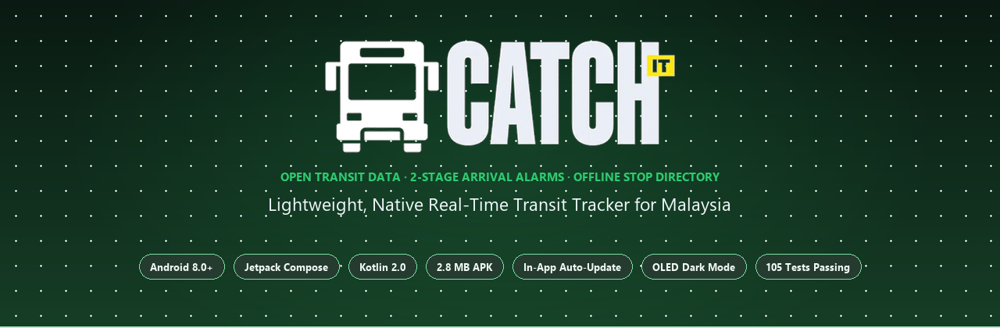
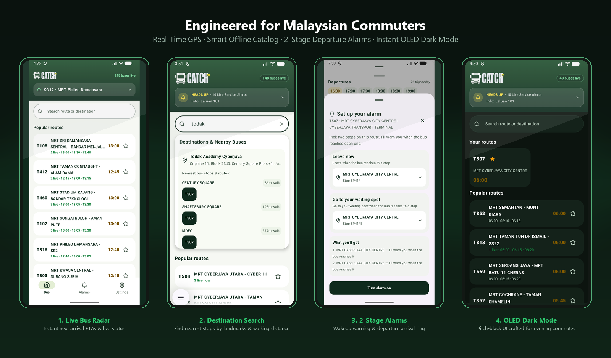
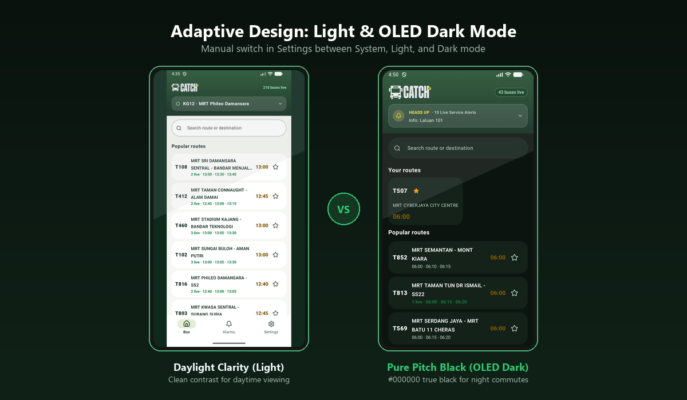

<div align="center">



<br/>

[](https://github.com/shintodd/CatchIt/releases/latest)
[](https://android.com)
[](https://developer.android.com/jetpack/compose)
[](https://kotlinlang.org)
[](https://github.com/shintodd/CatchIt/releases/download/v1.2.5/CatchIt-v1.2.5.apk)
[](https://github.com/shintodd/CatchIt/actions)
[](LICENSE)

<br/>

**Native real-time MRT feeder bus tracker for Malaysia.**  
Built with Kotlin & Jetpack Compose. Answers the daily transit question:  
*When does my feeder bus arrive, and when should I walk to the stop?*

<br/>

<p align="center">
  <a href="https://github.com/shintodd/CatchIt/releases/download/v1.2.5/CatchIt-v1.2.5.apk">
    
  </a>
  &nbsp;&nbsp;
  <a href="https://github.com/shintodd/CatchIt/releases/latest">
    
  </a>
</p>

</div>

---

## 📱 App Showcase

<div align="center">
  
</div>

---

## ⚡ Key Features

| Feature | Description |
| :--- | :--- |
| 🛰️ **Open AVL Telemetry** | 30-second live vehicle positioning from Prasarana & `data.gov.my` open GTFS-RT feeds with freshness indicators. |
| 🏢 **Landmark & Stop Search** | Search common landmarks, colleges, and malls (*Todak Academy, Dpulze, Sunway Pyramid, KLCC*) to see nearest stops and walking distance. |
| 🔔 **2-Stage Departure Alarms** | Set your stop — get an early alert when the bus reaches your warning stop, then a ring when it reaches your pickup stop. |
| ⚠️ **Live Service Alerts** | Route diversions, road closures, and maintenance alerts synced periodically in background via `WorkManager`. |
| 🌙 **OLED Dark & Light Modes** | Manual 3-way toggle (`System` / `Light` / `Dark`) with reactive theme switching and `#000000` dark canvas. |
| 🔄 **In-App Update Checker** | Background version check against GitHub Releases with 1-tap APK install prompt — no app store account required. |
| 📦 **Compact APK (2.8 MB)** | R8 full-mode minification with stripped debug metadata for fast installation and low storage footprint. |
| 🗺️ **MRT Feeder Stop Catalog** | Offline catalog covering all 91 Rapid KL MRT feeder routes (T-routes) across Klang Valley. |

---

## 🌓 Adaptive Design: Light & OLED Dark Mode

CatchIt provides clear readability for daytime travel and an OLED dark theme for night-time commutes.

<div align="center">
  
</div>

---

## 📲 Installation

### Option 1: Direct APK Download (Recommended)
1. Download **[`CatchIt-v1.2.3.apk`](https://github.com/shintodd/CatchIt/releases/download/v1.2.3/CatchIt-v1.2.3.apk)** directly to your Android device.
2. Open the downloaded file and tap **Install** (allow installation from unknown sources if prompted).
3. Open **CatchIt** — all future releases can be updated seamlessly with 1 tap in **Settings → Check for Updates**.

### Option 2: Build from Source
```bash
# Clone the repository
git clone https://github.com/shintodd/CatchIt.git
cd CatchIt

# Run unit test suite (105 tests)
./gradlew testDebugUnitTest

# Build optimized release APK
./gradlew assembleRelease
```
The output APK will be located at `app/build/outputs/apk/release/app-release.apk`.

---

## 🏗️ Architecture & Tech Stack

```
CatchIt
├── UI Layer           Jetpack Compose (Material 3) · Unidirectional Data Flow · Dynamic Motion Transitions
├── Presentation       StateFlow · SharedFlow · Lifecycle-aware ViewModel
├── Domain Layer       Use Cases · Pure Kotlin Data Models · 2-Stage Alarm State Machine
├── Data Layer         Prasarana AVL Feeds · data.gov.my GTFS-RT · Offline SQLite Room Catalog
└── Background Sync    AndroidX WorkManager (15-min background disruption polls & alarms)
```

- **Language**: Kotlin 2.0
- **UI Framework**: Jetpack Compose (Material 3)
- **Async & Concurrency**: Kotlin Coroutines & Flow
- **Background Tasks**: AndroidX WorkManager
- **Code Optimization**: ProGuard / R8 Full-Mode
- **Target SDK**: Android 15 (API 35) with Edge-to-Edge window insets
- **Min SDK**: Android 8.0 (API 26) — supports over 95% of active Android devices
- **Test Coverage**: 105 automated unit tests verifying AVL feeds, destination spatial indexing, alarm state transitions, and auto-updater headers.

---

## 📊 Open Data Sources

CatchIt is built on open public transit telemetry provided by the Government of Malaysia and public transport agencies:
- **Bus Telemetry & AVL**: Prasarana Malaysia Berhad
- **GTFS Schedules, Routes & Stops**: [`data.gov.my`](https://data.gov.my) under Open Government Licence - Malaysia
- **Landmark Geocoding**: OpenStreetMap contributors

---

## 📄 License

Distributed under the MIT License. See [LICENSE](LICENSE) for more details.

<div align="center">
  <sub>Built with ❤️ for commuters across Malaysia.</sub>
</div>
